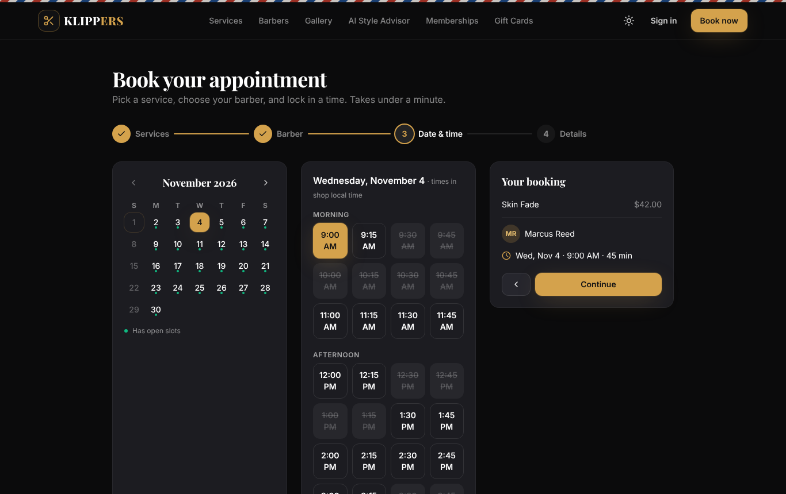

# ✂ Klippers — Barber Shop & Appointment Management

A full-stack, production-ready barber shop platform: real-time online booking, barber scheduling,
payments, loyalty rewards, an admin back office with analytics, and extras like QR check-in, a live
walk-in queue, a WhatsApp booking bot, gift cards, memberships and an AI style advisor.

| | |
|---|---|
| **Frontend** | React 18 · Vite · Tailwind CSS · Framer Motion · Recharts · Socket.IO client |
| **Backend** | Node.js 20+ · Express 5 · PostgreSQL 14+ (`pg`) · Zod · Socket.IO · node-cron |
| **Auth** | JWT access tokens (15 min) + rotating httpOnly refresh cookies · bcrypt · Google Sign-In · RBAC |
| **Integrations** (all optional) | Stripe · SMTP email · Twilio SMS/WhatsApp · Claude (Anthropic) for AI style advice |

Every integration has a working fallback (mock payments, console-logged email/SMS, rule-based
style advisor), so the whole app runs locally with **only PostgreSQL**.



---

## Feature map

| Area | What's implemented |
|---|---|
| **Roles** | Guest (browse + guest checkout + manage booking by code), Customer, Barber, Admin — enforced server-side by `authorize()` middleware and client-side by `ProtectedRoute` |
| **Customer** | Register/login/Google, profile & notification prefs, browse barbers (search/filter/sort), profiles with ratings, specialties, portfolio & reviews, services & pricing, 4-step animated booking, reschedule, cancel (auto-refund policy), history, favourites, confirmations, email/SMS/push notifications, reviews (+bonus points), online/cash/gift-card payment, invoices, loyalty points & tiers, waiting list |
| **Barber** | Self-registration (admin approval), profile, weekly hours with breaks, vacation/unavailable dates, offered services with custom price/duration, auto-confirm toggle, today's schedule, accept/reject requests, check-in → start → complete / no-show, earnings (commission) dashboard, revenue chart, stats, top customers, customer history & private notes, review replies, walk-ins & queue |
| **Admin** | KPI dashboard, users (search, role, suspend/activate, point adjustments), barbers (approve, location, commission), services CRUD, appointments (list + calendar, walk-ins), payments (invoices, partial/full refunds, cash settlement), review moderation, coupons, queue, reports with CSV export, business settings, locations, membership plans, gift cards |
| **Appointments** | Real-time slot availability (Socket.IO), day/week/month calendar, slot engine (hours, breaks, time off, lead time, booking window), **DB-level double-booking prevention**, confirmation workflow, 24h & 1h reminders, waiting list with auto-notify on cancellations, walk-in queue with ETA, walk-in bookings |
| **Payments** | Stripe PaymentIntents + webhook (or mock), cash, gift cards, invoice numbers & printable invoices, refunds, coupons, membership discounts, loyalty redemption, configurable tax |
| **Reporting** | Revenue, appointments (+busiest hours), customer retention cohorts, service popularity, barber performance — JSON or CSV |
| **Bonus** | AI hairstyle recommendations (Claude + rule fallback), before/after gallery slider, membership plans/subscriptions, gift cards, multi-location, QR check-in kiosk, WhatsApp booking bot |
| **UX** | Barber-themed dark & light modes, mobile-first layouts, animated booking flow, lazy-loaded route chunks, toasts, in-app notification centre |

---

## Project structure

```
klippers/
├── docker-compose.yml            # db + api + web (nginx) stack
├── package.json                  # convenience scripts for both apps
├── docs/
│   ├── API.md                    # every endpoint, role, payload
│   ├── DATABASE.md               # ER overview & integrity rules
│   ├── WIREFRAMES.md             # wireframes for every screen
│   └── screenshots/              # real renders of the app
├── server/                       # Express API
│   ├── Dockerfile · .env.example
│   ├── src/
│   │   ├── index.js              # HTTP server, sockets, migrations, jobs, graceful shutdown
│   │   ├── app.js                # Express app (security middleware + routes)
│   │   ├── config/env.js         # validated configuration
│   │   ├── db/
│   │   │   ├── schema.sql        # full PostgreSQL schema (idempotent)
│   │   │   ├── migrate.js · pool.js
│   │   │   └── seed.js           # deterministic demo data
│   │   ├── middleware/           # auth (JWT + RBAC), validate (Zod + sanitize), rateLimit, error
│   │   ├── services/             # availability, pricing, payment, notification, loyalty, settings, socket, ai
│   │   ├── routes/               # auth, catalog, barbers, appointments, payments, customer, admin, reports, extras, whatsapp
│   │   ├── jobs/reminders.job.js # 24h/1h reminders, expiry housekeeping
│   │   ├── utils/                # ApiError, jwt, time (tz), helpers
│   │   └── validators/common.js
│   └── tests/api.test.js         # end-to-end API tests (node:test + supertest)
└── client/                       # React SPA
    ├── Dockerfile · nginx.conf · .env.example
    ├── tailwind.config.js · vite.config.js · index.html
    └── src/
        ├── App.jsx               # lazy-loaded route map per role
        ├── lib/                  # api (axios + token refresh), socket, format (tz-aware)
        ├── context/              # AuthContext, ThemeContext
        ├── hooks/useFetch.js
        ├── components/
        │   ├── ui/               # Button, Card, Modal, Tabs, Table, StatCard, Stars, Toggle…
        │   ├── layout/           # Navbar, Footer, DashboardLayout, ProtectedRoute, NotificationBell
        │   ├── booking/          # MonthCalendar, SlotGrid, ServiceIcon
        │   ├── calendar/         # CalendarView (day / week / month)
        │   ├── appointments/     # AppointmentCard, Reschedule/Pay/Review/QR/Cancel modals, WalkInModal
        │   ├── charts/           # Revenue area, rank bars, columns, status donut
        │   └── BeforeAfter.jsx
        └── pages/
            ├── public/           # Home, Services, Barbers, BarberProfile, Book, Gallery, Memberships,
            │                     # GiftCards, StyleAdvisor, Queue, CheckIn, GuestBooking, Auth
            ├── customer/         # Dashboard, MyAppointments, Favorites, Rewards, Profile
            ├── barber/           # Dashboard, Calendar, Schedule, Services, Customers, Profile, StaffQueue, StaffReviews
            └── admin/            # Dashboard, Appointments, Customers, Barbers, Services, Payments, Coupons, Reports, Settings
```

---

## Quick start (local development)

Prerequisites: **Node.js 20+** and **PostgreSQL 14+**.

```bash
# 1. Database
createuser -P klippers          # password: klippers
createdb -O klippers klippers
psql -d klippers -c "CREATE EXTENSION IF NOT EXISTS btree_gist;"   # needs superuser once (or let the app create it if allowed)

# 2. Install
npm run install:all

# 3. Configure the API
cp server/.env.example server/.env      # defaults work for local dev

# 4. Create schema + demo data
npm run seed

# 5. Run (two terminals)
npm run dev:api     # http://localhost:4000
npm run dev:web     # http://localhost:5173  (proxies /api and websockets)
```

### Demo accounts (password `Password123`)
| Role | Email |
|---|---|
| Admin | `admin@klippers.app` |
| Barber | `marcus@klippers.app` (auto-confirms) · `diego@klippers.app` (manual approval) · `sophie@`, `andre@`, `liam@`, `kofi@klippers.app` |
| Customer | `john@example.com` (Gold Club member) · `emily@example.com` … `ethan@example.com` |

Coupons: `WELCOME10`, `FRESH5`, `SUMMER20` · Gift card: `GIFT-DEMO-2026` ($100)

### Tests
```bash
npm test     # ⚠ re-seeds the database in DATABASE_URL — point it at a dev/test DB
```
14 end-to-end tests cover auth & refresh rotation, RBAC, sanitisation, pricing, the full booking
lifecycle, **a concurrent double-booking race**, accept/reject/complete workflow, loyalty, reviews,
guest bookings, time off, dashboards & reports, suspension, queue, AI, WhatsApp, gift cards and jobs.

---

## Security

- **Passwords** hashed with bcrypt (12 rounds); constant-time login path (dummy hash for unknown emails).
- **JWT** access tokens kept in memory on the client (not localStorage); refresh tokens are random,
  stored **hashed**, rotated on every use, httpOnly + SameSite cookies scoped to `/api/auth`, revoked on
  logout, password reset and suspension.
- **RBAC** via `authenticate` + `authorize(...roles)`; resource ownership checks (customers see only
  their bookings, barbers only theirs). Suspended users are rejected on every request.
- **Validation & sanitisation**: every route validates params/query/body with Zod (unknown keys stripped);
  all strings are HTML-stripped; SQL is 100% parameterised; dynamic `SET` clauses only use Zod-whitelisted keys.
- **Rate limiting**: global, credential, and expensive-endpoint limiters.
- **Headers**: Helmet, strict CORS allow-list, body size limits; nginx adds `nosniff`/`DENY` frame headers.
- **Payments**: Stripe webhook signature verification on the raw body; amounts are always computed server-side.

---

## Deployment

### Option A — Docker Compose (single VM)
```bash
cp server/.env.example server/.env
# edit server/.env: set NODE_ENV=production, strong JWT_ACCESS_SECRET / JWT_REFRESH_SECRET,
# and any Stripe / SMTP / Twilio / Anthropic keys you want enabled
docker compose up -d --build
docker compose exec api node src/db/seed.js     # optional demo data
# Web: http://<host>:8080   API: http://<host>:4000/api/health
```
Put a TLS-terminating proxy (Caddy, Traefik, a cloud load balancer) in front of port 8080. In production
the refresh cookie is `Secure`, so the site must be served over HTTPS.

### Option B — Managed services
| Piece | Suggested host | Notes |
|---|---|---|
| PostgreSQL | Neon, Supabase, Render, RDS | Enable `btree_gist` (allowed on all of these). Set `DATABASE_SSL=true`. |
| API | Render / Railway / Fly.io / ECS | Build `server/Dockerfile` or `npm start`. Health check `/api/health`. Migrations run on boot. Needs WebSocket support. |
| Web | Vercel / Netlify / Cloudflare Pages / S3+CloudFront | `npm run build` in `client/`, publish `dist/`, SPA fallback to `index.html`. Set `VITE_API_URL=https://api.yourdomain.com`. |

Set `CLIENT_URL` on the API to the web origin (comma-separate several). When web and API live on
different domains the refresh cookie uses `SameSite=None; Secure` automatically in production.

### Production checklist
- [ ] Strong, unique `JWT_ACCESS_SECRET` / `JWT_REFRESH_SECRET` (the API refuses to boot without them in production)
- [ ] `STRIPE_SECRET_KEY`, `STRIPE_PUBLISHABLE_KEY`, `STRIPE_WEBHOOK_SECRET`; point a Stripe webhook at `/api/webhooks/stripe`
      (`payment_intent.succeeded`, `payment_intent.payment_failed`) and mount Stripe Elements with the returned `clientSecret` in `PayModal`
- [ ] SMTP credentials for email; Twilio credentials for SMS
- [ ] WhatsApp: in Twilio, set the WhatsApp sender's inbound webhook to `POST /api/webhooks/whatsapp`
- [ ] `GOOGLE_CLIENT_ID` (API) and `VITE_GOOGLE_CLIENT_ID` (web) for Google sign-in
- [ ] `ANTHROPIC_API_KEY` for AI style advice (uses `claude-opus-5-5` with server-side refusal fallback; rule-based otherwise)
- [ ] When running several API instances: `ENABLE_JOBS=true` on exactly one, and add the Socket.IO Redis adapter
- [ ] Database backups and log shipping

---

## How key pieces work

**Availability & double-booking.** `services/availability.service.js` builds the day's slots from the
barber's working hours (minus breaks, time off, existing active appointments, lead time and the booking
window) in the location's timezone. That powers the UI. Correctness under concurrency comes from the
PostgreSQL exclusion constraint `appointments_no_overlap`; a violation is mapped to HTTP 409
"That time slot was just booked", and the client refreshes the slots.

**Pricing.** `services/pricing.service.js` — barber price overrides → membership % → coupon → loyalty
points → tax. The same function serves the live quote and the booking, so the price shown is the price charged.

**Notifications.** `notifyUser()` writes an in-app notification, emails/SMSes according to the user's
preferences, and pushes it over Socket.IO; the browser shows a toast and a native Notification when the
tab is in the background. Reminders are claimed atomically (`UPDATE … RETURNING`) so they're never duplicated.

**Timezones.** Times are stored as UTC `timestamptz` and shown in the shop location's timezone
(`client/src/lib/format.js`), so customers and barbers always see the same wall-clock time.

**Charts.** Colours are CSS variables (`--series-1..4`) with separate, validated light and dark steps
(brand gold + blue/orange/aqua) that pass colour-vision-deficiency separation checks; every multi-series
chart has a legend with values, and reports include a table view.
